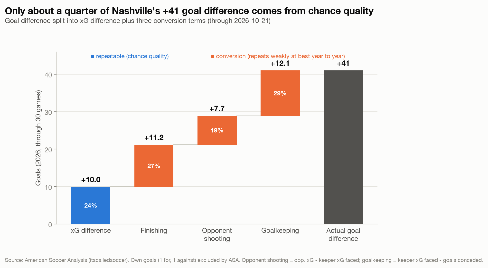
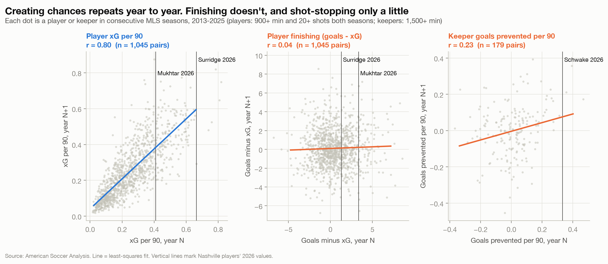
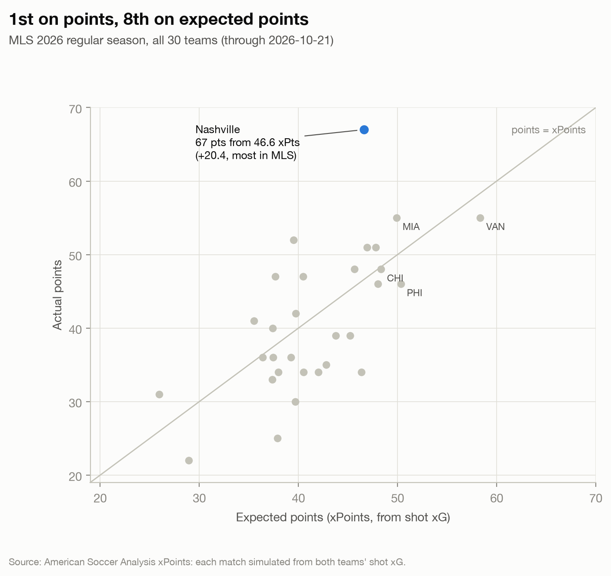

# Nashville playoff check: how much of 2026 will travel?

**The question:** Nashville SC lead MLS with the best record and the fewest goals conceded. Going into the playoffs, how much of that comes from chance creation and chance prevention that should hold up, and how much from finishing and goalkeeping that may cool off?

**The answer:** About a quarter comes from chance quality, the part that tends to hold up. Nashville's +41 goal difference rests on a +10.0 xG difference; the other +31.0 came from finishing (+11.2), opponents missing or misplacing their shots (+7.7) and goalkeeping (+12.1, of which Schwake +10.9). Across 13 MLS seasons, finishing above xG has not carried into the next season (r = 0.04) and shot-stopping only weakly (r = 0.23). On chance quality Nashville are a good team, 5th in xG difference per game, rather than the dominant one the table shows. On regressed rates they win about 48% of 90-minute games against an average opponent, not 69%.

**Interactive dashboard:** [raghav-aggarwal-20.github.io/nashville-playoff-check](https://raghav-aggarwal-20.github.io/nashville-playoff-check/)

*Data through 2026-10-21 (30 of 34 regular-season games). Source: American Soccer Analysis.*



## Key numbers

| | Nashville 2026 | MLS rank |
|---|---|---|
| Points / expected points | 67 / 46.6 (+20.4) | 1st / 8th |
| Goals for / xG for | 63 / 51.8 | 2nd / 12th |
| Goals against / xG against | 22 / 41.8 | 1st / 4th |
| xG difference per game | +0.33 | 5th (Vancouver +1.03) |
| Schwake goals prevented | 22 conceded on 32.9 keeper xG faced = +10.9 | 2nd (Matt Turner, New England, +12.4) |

Schwake's +10.9 is his own figure; team goalkeeping (+12.1) also includes Joe Willis's +1.2. Goals are shot goals as counted by ASA, so own goals (1 for, 1 against) are excluded; the scoreboard (64 scored, 23 conceded) gives the same +41.

## Does it repeat?



| Season N vs season N+1, MLS 2013-2025 | r | 95% CI | Pairs |
|---|---|---|---|
| Player xG per 90 (control) | 0.80 | 0.78 to 0.82 | 1,045 |
| Player finishing (goals minus xG) | 0.04 | -0.03 to 0.10 | 1,045 |
| Keeper goals prevented per 90 | 0.23 | 0.09 to 0.37 | 179 |
| Team xG difference per game (control) | 0.40 | 0.30 to 0.49 | 285 |
| Team finishing per game | 0.04 | -0.08 to 0.16 | 285 |
| Team opponent shooting per game | 0.08 | -0.04 to 0.19 | 285 |

Creating chances repeats; converting them does not. The finishing result holds under stricter filters (r between -0.01 and 0.11 from 20 to 80 shots in both seasons). Keeper r falls to 0.09 for keepers with 2,500+ minutes, so 0.23 is the generous figure for Schwake.

## Three players to check

- **Sam Surridge:** 17 goals from 15.7 xG. Three are penalties, so his non-penalty line is 14 from 13.4, close to expectation. His repeatable value is volume: 0.67 xG per 90, the highest on the team. Over his previous three MLS seasons he finished 1.0 goal below xG on 184 shots, including 24 goals from 26.8 xG in 2025.
- **Hany Mukhtar:** 16 goals from 12.7 xG with no penalties, +3.3. He has a modest track record: +3.7 over six prior seasons on about 590 shots, roughly +0.6 per 100 shots, with swings from +4.2 (2021) to -4.1 (2024). Expect something nearer his career rate than +3 a season.
- **Brian Schwake:** +10.9 goals prevented, 2nd in MLS, in his first season as Nashville's starter and with no prior MLS season in ASA's data. The sample is 102 shots on target. Keepers this far above average usually land much closer to average the following season.

<!-- sofascore:start -->
## Second opinion: Sofascore

*Context from Sofascore's MLS 2026 pages, read manually on 2026-10-23 (`data/sofascore_manual.csv`). These figures do not enter any calculation.*

- **Two models agree on Schwake.** ASA has him at +10.9 goals prevented; Sofascore at +8.96. Different models, same verdict: elite shot-stopping this season.
- **Penalties.** He saved 2 of 4. ASA values a penalty at 0.78 xG (3.13 xG on the 4 penalties Nashville faced), so 2 saves from 4 is worth about +1.1 goals against an average keeper (10% of his +10.9 ASA total). Penalty saves are the least repeatable part of a keeper's record: a handful of kicks, mostly decided by a guess.
- **Errors.** Nashville made 20 errors that led to a shot and 0 that led to a goal. That many errors without a goal conceded is not something to plan on repeating.
- **Surridge: 17 goals vs 16.79 xGOT.** xGOT (expected goals on target) adds shot placement to xG. His 13.76 xG becomes 16.79 once placement is counted, leaving only +0.2 unexplained. His goals come from where he puts the ball, not from keeper mistakes.
- **Mukhtar: 16 goals vs 13.78 xGOT,** about +2.2 beyond placement (his placement adds only +0.8 to 12.98 xG). Goals above xGOT are shots keepers should have saved, the part most likely to even out.
- **Schwake beyond shot-stopping:** 20 high claims, 0 crosses not claimed, 11/11 successful run-outs. That is value goals prevented doesn't capture: it only measures shots on target, not the shots that never happen because he took the cross.
- **Woodwork.** Nashville hit the post or bar 12 times. xG already counts those chances, and they went in the books as misses, so the finishing term (goals minus xG) already reflects them.

Where the two sources differ, it is definitional:

- **Goals conceded:** Sofascore has Schwake on 23; ASA on 22. Sofascore matches the scoreboard, which includes the one own goal; ASA's xG tables count shot goals only.
- **Minutes:** Sofascore 2610, exactly 90 x his 29 starts; ASA 2935, which includes stoppage time.
<!-- sofascore:end -->

## What it means for the playoffs

| Scenario (per game) | GF | GA | GD | Win in 90 vs average opponent |
|---|---|---|---|---|
| Actual 2026 | 2.10 | 0.73 | +1.37 | 69% |
| Pure xG | 1.73 | 1.39 | +0.33 | 45% |
| Projected (each conversion term kept at its r) | 1.74 | 1.28 | +0.46 | 48% |

- **Defensive structure is real but not elite.** Nashville are 4th in xG against. The 22 goals conceded reflect goalkeeping and opponent finishing more than structure; plan for 1.2 to 1.3 goals against per game.
- **The attack runs on volume.** Surridge's chance volume should hold; finishing above xG across the squad probably will not.
- **Against the best chance-quality sides** (Vancouver, +1.03 xG difference per game), Nashville would not be favourites on the underlying numbers.
- **Knockout games are short samples.** Variance can still favour Nashville, but preparation should not rely on it.



## Method

1. **Decomposition.** Goal difference = xG difference + finishing + opponent shooting + goalkeeping, an exact identity built from two xG measures. ASA's pre-shot xG values every shot by location and situation; its keeper xG faced values only shots on target, by placement. Opponent xG minus keeper xG faced is chance quality opponents lost to misses, blocks and poor placement. Keeper xG faced minus goals conceded is the keepers' contribution.
2. **Persistence.** Each measure is correlated between consecutive regular seasons, 2013 to 2025. Players: 900+ minutes and 20+ shots in both seasons. Keepers: 1,500+ minutes. 95% intervals use the Fisher z-transform.
3. **Projection.** Each conversion term is multiplied by its r and added back to xG (team r for finishing and opponent shooting; keeper r for goalkeeping). Win, draw and loss probabilities treat goals for and against as independent Poisson draws against an average-strength opponent.

## Data and checks

- **American Soccer Analysis** via [`itscalledsoccer`](https://github.com/American-Soccer-Analysis/itscalledsoccer-python) 2.3.0, cached as parquet in `data/` with pull times in `data/pull_log.json`. Player names come from the same ASA API directly, because `get_players()` in 2.3.0 fails on mismatched pages.
- **Sofascore** figures were read manually into `data/sofascore_manual.csv` and are used for context only.
- **17 sanity checks** run before any output is built and stop the pipeline on failure. They confirm the record (20W 7D 3L, 67 points, 64 scored, 23 conceded) against public standings, reconcile own goals, check that player goals sum to team goals, and check that keeper goals conceded match team goals against in all 346 MLS team-seasons since 2013.

## Caveats

- **Standings source.** Public standings were checked against a third-party table, not mlssoccer.com. Surridge's (17) and Mukhtar's (16) goal totals match Sofascore.
- **Blocked shots.** Opponent shooting includes blocked shots, so part of the +7.7 may be Nashville defending rather than opponent error.
- **Roster turnover.** Year-to-year r includes roster turnover and may understate persistence for a settled squad.
- **Model differences.** Different providers' xG models differ; see the Sofascore section.
- **Incomplete season.** Four regular-season games remain, and figures will move slightly after Decision Day.

<details>
<summary>Reproduce the analysis</summary>

```bash
python3 -m venv .venv && .venv/bin/pip install -r requirements.txt
.venv/bin/python -m src.run
```

One command runs the sanity checks and rebuilds every table in `output/`, the charts and the dashboard from cached ASA data.
</details>

---

Analysis by Raghav Aggarwal · [GitHub](https://github.com/Raghav-Aggarwal-20) · [LinkedIn](https://www.linkedin.com/in/raghav-aggarwal-a4b5721bb)
